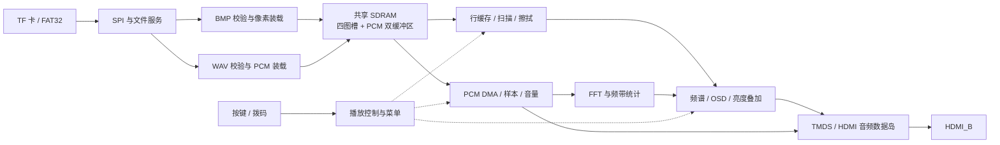

# FPGA 智能多媒体展播终端

基于**康芯 HX4S20C 开发板**和**安路 EG4S20BG256 FPGA** 的离线图片与短配音展播系统。使用 Verilog 实现 TF 卡读取、FAT32 文件解析、SDRAM 缓存、HDMI 音视频输出和本地交互，播放过程不依赖软核 CPU、外部 MCU 或网络。

四组图片和同编号配音存放在 TF 卡中，可按键切换或自动轮播，并叠加播放状态、菜单和音频频谱，适合实验步骤讲解、展品介绍和教学演示。

**阅读入口：** [快速开始](#快速开始) · [操作说明](#按键与菜单) · [工程构建](#工程构建) · [详细技术设计](docs/TECHNICAL_DESIGN.md)

## 功能与规格

| 项目 | 当前默认配置 |
| --- | --- |
| 平台 | HX4S20C / EG4S20BG256，板载 50 MHz 晶振 |
| 存储 | FAT32 TF 卡，SPI 读取，8 MiB 合封 SDRAM 缓存 |
| 图片 | 四幅 640×480 BMP24 或标准 RGB565 BMP，支持正负高度 |
| HDMI 输出 | 固定 1280×720 @ 60 Hz，画面与 LPCM 音频共用 HDMI_B |
| 转场 | 18 帧水平擦拭，约 0.3 秒 |
| 配音 | 同编号 PCM WAV，48 kHz、16 位、双声道、1 至 5 秒 |
| 频谱 | 512 点串行 FFT，16 个显示频带 |
| 控制 | 手动切图、自动轮播、可配置周期、OSD 菜单 |
| 亮度与音量 | 亮度 01–16；音量 00–16，00 静音；默认均为 16 |
| 异常处理 | 读卡重试、无效文件处理、测试音回退和拔卡后重新初始化 |

当前版本面向**静态图片与短配音**，不解码 MP4 等连续视频，也不接受 JPEG、PNG、MP3、AAC。BMP32 在默认顶层关闭。HDMI 使用固定时序，不通过 EDID 自动选择分辨率。

## 系统架构



文件读取与视频扫描分别运行。图像和音频通过完整校验、实际缓存写入及提交后，才成为可播放资源；描述符、引用和跨域握手协调换图与配音，避免读取未装载完成的数据。模块职责、内存规划和提交协议见 [技术设计](docs/TECHNICAL_DESIGN.md)。

## 快速开始

1. 准备 HX4S20C 开发板、TF 卡、HDMI 线、支持 720p 的显示设备和板卡要求的电源。配音需要接收端具备 HDMI 音频播放能力。
2. 将 [media/MEDIA](media/MEDIA/) **整个文件夹**复制到 FAT32 TF 卡根目录，形成 `MEDIA/P0001.BMP` 等路径。复制前备份卡内原文件。
3. 按板卡说明连接电源、下载器和 **HDMI_B**。引脚以 [multimedia.adc](td/multimedia.adc) 为准。
4. 按[工程构建](#工程构建)生成 `multimedia_top.bit`，使用与板卡匹配的下载器下载到开发板。
5. 等待首图装载与提交后，使用 K1 切图、K2 启停轮播、K3/K4 调整菜单。

仓库示例包含四张图片和四段同编号音频，图片覆盖 BMP24/RGB565 和正负高度；四段配音均为 48 kHz、16 位、双声道、3 秒，可直接用于格式与功能演示。

## 按键与菜单

| 操作 | 作用 |
| --- | --- |
| K1 按下 | 请求下一张可用图片 |
| K2 按下 | 启停自动轮播 |
| K3 短按 | 打开菜单，依次选择 MODE → PERIOD → DISP → BRIGHT → VOLUME → 关闭 |
| K4 短按 | 增加参数或向前切档 |
| K4 长按约 750 ms | 减少参数或反向切档，一次长按操作一次 |

菜单打开后使用 K4 调节参数；K3 长按和菜单关闭时的 K4 操作均不改变参数。

| 菜单 | 含义 |
| --- | --- |
| MODE | 短按 K4 进入自动模式，长按返回手动模式 |
| PERIOD | 1、2、3、5、10、15、20、30、45、60 秒，到达端点后保持 |
| DISP | ALL 全显示；NOID 隐藏状态行；NOSP 隐藏频谱；OFF 隐藏两者 |
| BRIGHT | 亮度 01–16，默认 16 |
| VOLUME | 音量 00–16，默认 16，00 静音 |

SW1/SW2 在初始化时设置初始轮播周期。按电气逻辑 `{SW2,SW1}`，`00/01/10/11` 对应 `1/5/10/30` 秒；开关位置与逻辑电平的对应关系以板卡标识和接线为准。系统上电进入手动模式，运行中通过 PERIOD 菜单修改周期。OSD 中的 `015S` 表示 15 秒。

## 素材准备

```text
TF 卡根目录/
└── MEDIA/
    ├── P0001.BMP
    ├── P0001.WAV
    ├── P0002.BMP
    ├── P0002.WAV
    ├── P0003.BMP
    ├── P0003.WAV
    ├── P0004.BMP
    └── P0004.WAV
```

- **图片**：固定 640×480，导出为未压缩 BMP24（BI_RGB）或标准 RGB565 BMP（BI_BITFIELDS），RGB565 的 R/G/B 掩码为 `0xF800/0x07E0/0x001F`。
- **音频**：未压缩 PCM WAV，48 kHz、16 位、双声道；PCM 数据为 192000–960000 字节且按 4 字节对齐，完整 WAV 文件不超过 983040 字节。
- **配对**：同编号 WAV 为对应图片配音。OSD 的 WAV 表示使用配音，TONE 表示使用测试音回退；配音缺失或无效时自动使用测试音。

如电脑装有 FFmpeg，可转换为统一的 3 秒配音：

```bash
ffmpeg -i input.wav -af apad -t 3 -ar 48000 -ac 2 -c:a pcm_s16le P0001.WAV
```

不足 3 秒时补静音，超出时截取。完整格式要求见技术文档。

## 工程构建

| 项目 | 设置 |
| --- | --- |
| 工具 | 安路 Tang Dynasty 6.2.1 |
| 器件 | `eagle_s20.db` / `EG4S20BG256` |
| 顶层 | `multimedia_top` |
| 源码清单 | [td/multimedia_top.f](td/multimedia_top.f)，85 个 Verilog 文件 |
| 引脚 / 时序 | [multimedia.adc](td/multimedia.adc) / [multimedia.sdc](td/multimedia.sdc) |
| 构建脚本 | [BUILD.tcl](BUILD.tcl) |

### GUI 方式

新建 EG4S20BG256 工程，按清单导入源码，添加 ADC/SDC，再运行综合、布局布线和位流生成。本工程采用 **GUI MultiSeed seed 20**，已完成上板运行验证。

### 命令行方式

在仓库目录运行，工具路径按本机安装位置替换：

```powershell
& 'D:/Anlogic/TD6.2.1/bin/td_commands_prompt.exe' ./BUILD.tcl
```

脚本按自身位置定位输入，设置 seed 20，在**仓库同级** `build/td_时间戳/` 创建本次构建目录，生成 `multimedia_top.bit`、`route.ts`、`route.timing` 和 `route_exception.timing`。构建完成后检查本次资源和时序报告，再下载对应位流。源码、工具版本、约束和构建输出应配套保存。

## 实现结果

以下数据依据 **GUI MultiSeed seed 20** 的 [运行日志](timing_seed20/run.log) 和 [路由时序报告](timing_seed20/hdmi_player_pr.timing)。

| 资源 | 使用量 / 总量 | 利用率 |
| --- | ---: | ---: |
| LUT | 16579 / 19600 | 84.59% |
| 寄存器 | 10642 / 19600 | 54.30% |
| BRAM9K | 25 / 64 | 39.06% |
| BRAM32K | 4 / 16 | 25.00% |
| DSP | 5 / 29 | 17.24% |
| PLL | 3 / 4 | 75.00% |

路由建立时间（setup）最差裕量为 **+0.118 ns**，保持时间（hold）最差裕量为 **+0.120 ns**，建立与保持时间总负裕量 STNS/HTNS 均为 0。详细实现参数和部署检查方法见[技术文档](docs/TECHNICAL_DESIGN.md#12-实现结果与部署检查)。

## 目录结构

```text
.
├── README.md
├── BUILD.tcl
├── docs/TECHNICAL_DESIGN.md   # 详细原理与复现说明
├── rtl/
│   ├── top/                 # 整机顶层
│   ├── storage/             # SD SPI、FAT32 与文件服务
│   ├── media/               # BMP/WAV 校验与装载
│   ├── sdram/               # 共享调度、初始化与刷新
│   ├── video/               # 行缓存、扫描、擦拭、OSD 与叠加
│   ├── audio/               # PCM、音量、FFT 与频带统计
│   ├── control/             # 播放、按键、拨码与菜单
│   ├── hdmi/                # TMDS、数据岛与发送
│   ├── platform/            # PLL、RAM 与器件原语封装
│   ├── common/              # 复位、FIFO、mailbox 与 CRC
│   └── include/             # 配置与内存映射
├── td/                      # 文件清单、ADC 与 SDC
├── media/MEDIA/             # 示例四图四配音
└── timing_seed20/           # 运行日志及路由报告
```

## 常见问题

| 现象 | 优先检查 |
| --- | --- |
| 无 HDMI 画面 | 供电、下载、HDMI_B、线缆、显示器是否支持 720p |
| 不能读取自定义图片 | FAT32、MEDIA 位置、命名、尺寸、位深与实际 BMP 文件头 |
| 有声音但没有配音 | 同编号 WAV、PCM 编码、采样率、位宽、声道及长度，观察 WAV/TONE 状态 |
| K4 不响应 | 先用 K3 打开菜单，再区分短按与长按 |
| 改拨码后周期不变 | 拨码只初始化读取；运行中用 PERIOD 调整 |
| 重建后时序不同 | 核对工具、源码、约束、seed，并查看本次路由结果 |

## 致谢

感谢赛事组委会、安路科技与康芯科技对本作品的支持与帮助。
