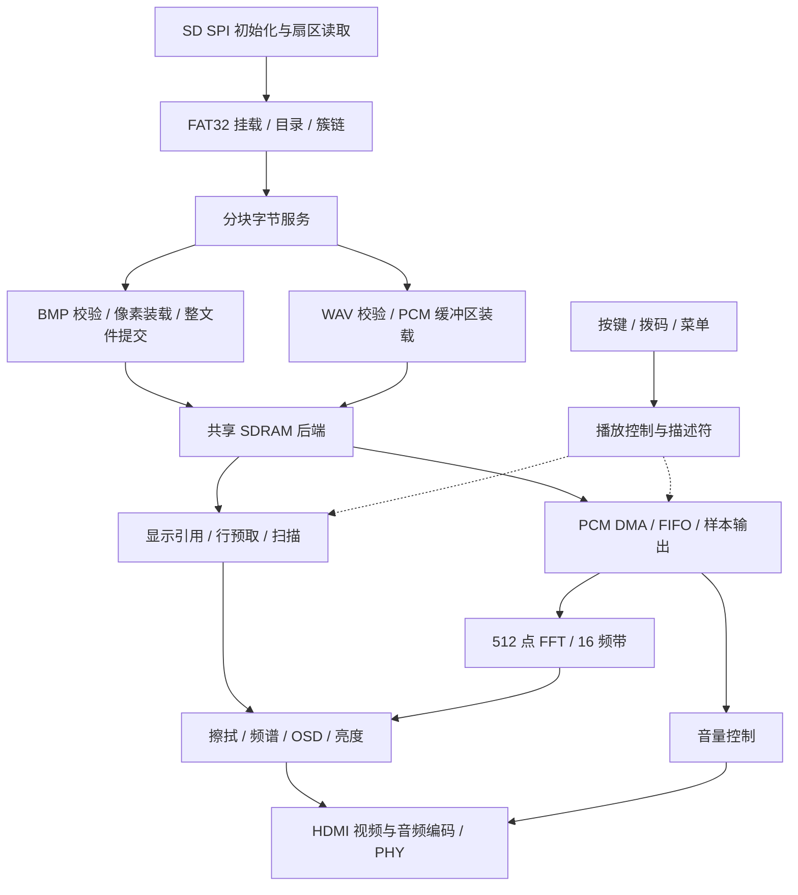

# FPGA 智能多媒体展播终端技术设计

本文用于系统交接与工程维护，说明模块职责、硬件连接、数据流、时钟、缓存管理、工程构建和部署检查方法。首次使用按 [README](../README.md) 完成素材准备和整机操作，维护时通过本文定位源码与接口。

本说明对应 **GUI MultiSeed seed 20** 工程。功能与接口由 RTL、ADC 和 SDC 定义，资源和时序参数见 timing_seed20 目录中的实现报告。

## 1 设计目标与范围

系统把 TF 卡中的四幅图片和同编号短配音组织成离线展示序列。FPGA 独立完成文件访问、格式检查、图像缓存、播放交互和 HDMI 发送，不通过软核 CPU 执行播放器程序。PC 只用于准备素材、构建和下载。

系统保存四幅 640×480 BMP24/RGB565 图片，输出 1280×720、标称 60 Hz 的画面；每幅图片配对一段 1 至 5 秒 PCM WAV。四个图像槽常驻 SDRAM，配音在两个 PCM 缓冲区中交替装载与播放。

媒体装载与实时输出分别运行，显示扫描维持固定行场时基，后台读取通过行缓存、PCM 缓冲区和接口握手供给数据。文件校验、数据写入与资源提交依次完成后，播放模块开始使用相应图像或配音。频谱采用串行 FFT，复用运算资源完成分析。

## 2 系统分层



| 层次 | 主要入口 | 职责 |
| --- | --- | --- |
| 整机 | [multimedia_top.v](../rtl/top/multimedia_top.v) | 时钟复位与全部业务接线 |
| 存储服务 | [fat32_storage_services.v](../rtl/storage/fat32_storage_services.v) | 挂载、目录、文件字节服务 |
| 卡接口 | [sd_spi_media_port.v](../rtl/storage/sd_spi_media_port.v) | SD 初始化、SPI 访问与扇区传输 |
| 图像 | [bmp_header_check.v](../rtl/media/bmp_header_check.v)、[bmp_file_commit.v](../rtl/media/bmp_file_commit.v) | 格式、像素与整文件提交 |
| 音频装载 | [wav_parser.v](../rtl/media/wav_parser.v)、[wav_sdram_loader.v](../rtl/audio/wav_sdram_loader.v) | PCM 格式校验与缓冲区写入 |
| SDRAM | [sdram_shared_rw.v](../rtl/sdram/sdram_shared_rw.v)、[sdram_stream_controller.v](../rtl/sdram/sdram_stream_controller.v) | 客户端仲裁、初始化、刷新与完成回执 |
| 显示 | [display_row_bundle.v](../rtl/video/display_row_bundle.v)、[bundle_scanout.v](../rtl/video/bundle_scanout.v) | 行缓存预取、使用和释放 |
| 控制 | [b3_control.v](../rtl/control/b3_control.v)、[play_ctrl.v](../rtl/control/play_ctrl.v) | 启动交接、切图与轮播 |
| 频谱 | [spectrum_top.v](../rtl/audio/spectrum_top.v) | 样本旁路、FFT 与显示结果发布 |
| 叠加 | [osd_overlay.v](../rtl/video/osd_overlay.v) | 状态、菜单、亮度和帧快照 |
| HDMI | [hdmi_data_island_tx.v](../rtl/hdmi/hdmi_data_island_tx.v)、[tmds_gearbox20_phy.v](../rtl/hdmi/tmds_gearbox20_phy.v) | 音视频符号、数据岛与发送 |

## 3 硬件连接

硬件采用康芯 HX4S20C 开发板，核心器件为安路 EG4S20BG256，SDRAM 与 FPGA 合封。系统使用板卡电源、50 MHz 晶振、TF 卡接口与 HDMI_B。将开发板放置在绝缘支撑面上，按板卡要求连接电源、下载器和 HDMI 接收设备。

| 接口 | 信号 | ADC 引脚 | 用途 |
| --- | --- | --- | --- |
| 晶振 | clk_50m | R7 | 50 MHz 参考 |
| TF SPI | tf_cs_n / tf_sclk / tf_mosi / tf_miso | A12 / A14 / A13 / B14 | 本地媒体读取 |
| K1 / K2 | key1 / key2 | A2 / B2 | 切图 / 轮播，低有效 |
| K3 / K4 | key3 / key4 | B1 / C1 | 菜单 / 参数，低有效 |
| SW1 / SW2 | switches[0] / [1] | C8 / C7 | 初始化周期 |
| LED | auto_mode | A4 | 自动模式，首图前兼作启动错误闪码 |
| 蜂鸣器 | buzzer_n | H11 | 低有效，SW5 为板上物理使能 |
| HDMI 数据 P 端 | hdmi_d_p[2:0] | E1 / F1 / G5 | LVDS33 |
| HDMI 时钟 P 端 | hdmi_clk_p | C3 | LVDS33 |

引脚分配见 [multimedia.adc](../td/multimedia.adc)。HDMI N 端由工具根据器件差分对配对。HDMI 输出使用固定 720p 时序，接收设备需支持该输入模式；配音播放需使用具备 HDMI 音频能力的设备。

## 4 时钟与复位

### 4.1 时钟关系

| 时钟 | seed 20 报告频率 | 主要用途 |
| --- | ---: | --- |
| sys | 50.000 MHz | 文件、控制、按键、菜单 |
| mem | 100.000 MHz | SDRAM 调度和控制 |
| device | 100.000 MHz | SDRAM 器件时钟 |
| video_ref | 26.999 MHz | 第二级视频 PLL 参考 |
| pix | 74.250 MHz | 图像扫描、叠加、音频样本使能、频谱 |
| word | 37.125 MHz | HDMI 数据打包 |
| gear | 185.632 MHz | HDMI 位宽转换 |
| serial | 371.333 MHz | HDMI 串行发送 |

视频采用两级 PLL：50 MHz 到约 27 MHz，再生成像素及相关发送时钟；存储使用独立 PLL。上表数值来自 seed 20 路由时序报告的 Clock Summary。设计标称像素时钟为 74.25 MHz，总时序为 1650×750，对应刷新率 `74250000 / 1650 / 750 = 60 Hz`。报告中 device 时钟上升沿相对 mem 延后 7.388 ns。

音频在像素时钟域内通过 48 kHz 样本使能更新。像素和 word/gear/serial 由同一视频 PLL 产生，作为相关时钟参与时序分析。

### 4.2 复位和跨域

顶层检测上电状态和三个 PLL 的锁定状态，锁定连续保持 1000000 个 50 MHz 周期，即约 20 ms 后释放各域业务复位。PLL 失锁时重新进入复位流程，随后重新建立媒体和播放状态。

各域通过 `reset_sync` 异步置位、同步释放。RAM 和数据流水通过有效标志及控制状态管理可用性。跨域接口使用带确认的邮箱（mailbox）、异步先进先出队列（FIFO）或双时钟 RAM；请求、确认和资源引用在交接过程中保持对应关系，确保多位数据的一致性。

SDC 分别定义时钟关系、同步入口、握手保持总线和 Gray 指针的约束。SDRAM device 相位、PHY 寄存器与读捕获附加延迟共同决定读写采样关系，维护这些参数时应同步检查对应约束。

## 5 文件读取与分块服务

### 5.1 启动流程

启动依次完成 SD SPI 初始化、FAT32 参数解析和 MEDIA 目录扫描，再定位编号 BMP/WAV。扇区读取、预取和字节传输通路向解析与装载模块供数，接收端通过 ready 信号控制接受时机。

一份媒体文件依次经过请求接受、数据接收、格式解析、SDRAM 写入和资源提交。首图完成装载与提交后开始显示，启动控制将播放权限交给正常播放控制模块，后续切图由按键或轮播请求驱动。

### 5.2 分块上下文

默认 `P0_CONTEXT_ENABLE=1`，文件服务按 512 字节分块推进，并保存文件游标、事务身份及继续读取所需的上下文。底层沿 FAT 簇链取数据；返回结果需与当前会话匹配，避免取消、拔卡或重新挂载后的旧响应污染新文件。

文件服务在本工程中连接一个客户端，上下文记录用于保存分块读取位置和事务状态。

### 5.3 文件长度检查

文件服务先对完整 32 位文件长度进行范围检查，再将通过检查的长度用于较窄计数器。超限状态独立保存，内部计数器仅处理已确认有效的长度。例如 `0x01000200` 包含高位超限信息，完整长度检查可避免将其按低位数值 512 字节处理。

### 5.4 分块完成条件

分块完成表示本块数据已处理完毕，文件服务可以推进读取位置或释放上下文。完成条件同时覆盖输入暂存、解析与组包流水、待提交写请求和已接受但未完成的 SDRAM 写入。

最后一个输入字节被接受后，装载模块继续处理暂存与组包数据，提交剩余写请求，待所有相关写入完成后返回本块完成确认。中间块不足 BL8 的数据与下一块连续拼接，文件结束时再补齐最后一次突发。取消操作先停止提交后续请求，待已接受事务结束后释放对应资源。

## 6 BMP 装载与图像发布

### 6.1 格式要求

| 属性 | 默认要求 |
| --- | --- |
| 尺寸 | 宽 640，高 +480 或 −480 |
| 位深 | 24 位 BMP 或 16 位标准 RGB565 |
| 压缩标志 | BMP24 为 BI_RGB；RGB565 为 BI_BITFIELDS |
| RGB565 掩码 | R/G/B 为 `0xF800/0x07E0/0x001F` |
| BMP32 | `BMP32_EN=0`，默认关闭 |

解析器检查标识、头部、尺寸、位深、像素偏移和文件边界，并根据高度正负处理 bottom-up/top-down 顺序。图片在 SDRAM 统一保存为 `0x00RRGGBB` 32 位像素字，显示侧读取统一格式。

### 6.2 槽位提交

图像完成文件读取、格式检查、像素数量核对与 SDRAM 写入后，`bmp_file_commit` 提交目标槽，将其标记为可播放资源。任何一项检查失败时，本次装载返回错误状态。

物理槽号与装载代次 generation 共同标识槽内内容，播放描述符指定目标及其标识。显示和擦拭模块使用图像期间持有引用，新旧图像在转场中同时可用。旧图使用结束后，通过切换确认和释放协议回收对应引用。

### 6.3 行缓存与扫描

显示侧通过 `display_row_bundle` 和 `bundle_scanout` 组织行缓存组、预取和双行缓存，依次管理申请、就绪、显示与释放。源行和采样相位跟随实际光栅坐标，缓存准备与显示读取通过描述符关联。

显示读取具有逐行完成的时间要求，存储仲裁结合行截止时间安排请求。发生供数不足时，扫描模块记录状态并跳过已错过的输出行，随后继续按当前扫描位置取数。默认界面使用四幅主图，缩略图地址保留用于扩展。

### 6.4 转场和像素流水

`wipe_ctrl` 使用 18 帧水平擦拭切换新旧图片，约 0.3 秒。首次显示直接输出新图。各级转场、频谱、OSD 和亮度流水对 RGB、DE、HS、VS 与坐标进行一致延迟，使像素内容与有效区域保持对齐。

## 7 SDRAM 内存与调度

### 7.1 字节地址规划

以下来自 [mem_map.vh](../rtl/include/mem_map.vh)，区间右端不包含。32 位字地址接口需要将字节地址右移两位。

| 区域 | 起始 | 结束 | 预留容量 |
| --- | --- | --- | --- |
| 图槽 0 | 0x000000 | 0x140000 | 1.25 MiB |
| 图槽 1 | 0x140000 | 0x280000 | 1.25 MiB |
| 图槽 2 | 0x280000 | 0x3C0000 | 1.25 MiB |
| 图槽 3 | 0x3C0000 | 0x500000 | 1.25 MiB |
| PCM A | 0x500000 | 0x600000 | 1 MiB |
| PCM B | 0x600000 | 0x700000 | 1 MiB |
| 缩略图保留区 | 0x700000 | 0x740000 | 256 KiB |
| 工作保留区 | 0x740000 | 0x800000 | 768 KiB |

单图有效数据 `640×480×4 = 1228800` 字节，四图合计 4915200 字节。每个图像槽预留 1.25 MiB，PCM A/B 各预留 1 MiB，缩略图保留区和工作保留区分别为 256 KiB 和 768 KiB，各区域按固定边界管理。

### 7.2 共享控制

显示读取、PCM DMA 与装载写入共用一套后端，统一控制初始化、刷新、存储体时序和实际 SDRAM 命令。显示行期限、PCM FIFO 紧急需求与后台写入保护共同影响服务顺序。

一次 BL8 突发包含 8 个 32 位数据字。存储控制器接受写段后完成规定数据拍，再返回完成确认。mem 为 100 MHz，刷新间隔和刷新宽限各 750 拍，即 7.5 μs；最大开行时间为 8000 拍，即 80 μs。PHY 相位、读延迟与 SDC 采样关系配套设置。

## 8 WAV 配音与音量

### 8.1 输入格式

解析 RIFF/WAVE、fmt、data 及块边界，只接受 PCM 格式标识 1、2 声道、48000 Hz、16 位、block align 4、byte rate 192000。PCM data 长度 192000–960000 字节且为 4 的倍数，完整 WAV 不超过 983040 字节。

每个双声道样本帧包含左右声道各一个 16 位样本，共 4 字节，因此数据率为 `48000×2×2 = 192000` 字节/秒。准备素材时，将原始音频转换为上述 PCM WAV 格式，并保持 1 至 5 秒时长。

### 8.2 双缓冲区与声画切换

WAV 写入未发布 PCM 缓冲区，整文件检查、尾块处理及后端写入合格后才允许引用。双缓冲区将当前播放和下一段准备分开，防止覆盖正在读取的数据。

`wav_audio_control` 协调缓冲区准备、取消和完成确认，使用缓冲区编号与令牌 bank/token 匹配响应。DMA 经 FIFO 向样本口供数，音量模块调节送往 HDMI 的 PCM 幅度。显示引用与音频选择按已提交的播放描述符关联，缓冲区在使用结束并释放引用后再次装载。

配音缺失或无效时使用测试音回退。OSD 的 WAV 表示对应配音，TONE 表示测试音，可用于确认当前音源。音量 00 为静音，01–16 通过平滑增益过渡调节输出。

## 9 频谱与 OSD

频谱在音量调节前旁路取得左右声道样本的平均值。512 点串行 DIT FFT（按时间抽取的快速傅里叶变换）使用定点运算，将结果归并为 16 个频带并按帧更新柱高。频谱分析与主音频输出分别运行，调整输出音量不改变分析输入。

柱高由 FFT 结果经定点缩放和显示映射生成，用于观察音频的相对变化。左右反相信号可能在平均时抵消。隐藏频谱只关闭显示叠加，后台分析继续运行。

OSD 状态经 mailbox 进入像素域，在垂直消隐处快照，帧内保持稳定。图片 ID 和 WAV/TONE 取实际已提交引用，避免菜单状态先于真实播放生效。亮度处理和文本、频谱沿同步像素流水叠加。

| 菜单 | K4 短按 | K4 长按 | 档位规则 |
| --- | --- | --- | --- |
| MODE | AUTO | MAN | 按需切换 |
| PERIOD | 下一档 | 上一档 | 1/2/3/5/10/15/20/30/45/60 秒，到达端点后保持 |
| DISP | 正向切换 | 反向切换 | ALL / NOID / NOSP / OFF 循环 |
| BRIGHT | 增亮 | 减亮 | 01–16，到达端点后保持 |
| VOLUME | 增大 | 减小 | 00–16，到达端点后保持 |

按键先同步，再以 1 ms 间隔取得 20 个稳定样本完成消抖。K3 短按打开或选择下一项菜单，长按不改变参数；K4 长按门限约 750 ms，一次按键执行一次对应操作。SW1/SW2 在初始化时锁存，系统上电进入手动模式，K2 启停自动轮播。OSD 周期以秒表示，`015S` 表示 15 秒。

## 10 自主 HDMI

发送路径包括视频 TMDS 编码、TERC4、音频数据岛、InfoFrame、ACR 以及符号打包和器件 PHY。视频与 LPCM 经同一 HDMI_B 输出，不通过外接播放器完成配音。

HDMI 固定输出 720p60，使用支持该模式的接收设备。需要配音时，同时检查接收设备的 HDMI 音频输入、扬声器和音量设置。音源状态通过 OSD 的 WAV/TONE 查看。

## 11 素材与工程复现

### 11.1 素材检查

先用仓库原素材排除接线和构建问题，再逐个替换 BMP 和同编号 WAV。可使用以下命令生成并检查统一 3 秒配音：

```bash
ffmpeg -i input.wav -af apad -t 3 -ar 48000 -ac 2 -c:a pcm_s16le P0001.WAV
ffprobe -v error -show_entries stream=codec_name,sample_rate,channels,bits_per_sample -of default=noprint_wrappers=1 P0001.WAV
```

转换后的编码、采样率、声道数和样本位宽应分别为 pcm_s16le、48000、2、16，同时检查 PCM 数据长度和完整文件大小。BMP24 使用 BI_RGB，RGB565 使用标准 BI_BITFIELDS 颜色掩码。

### 11.2 构建输入

使用 TD 6.2.1，器件 eagle_s20.db / EG4S20BG256，顶层 multimedia_top。`td/multimedia_top.f` 包含 85 个活动 Verilog 文件；另有两个头文件。ADC/SDC 与源码一起决定硬件实现，按产品清单导入，避免混入其他配置。

GUI 构建采用 MultiSeed seed 20。`BUILD.tcl` 设置 `set_param place seed 20`，按脚本位置定位源码与约束，在仓库同级 `build/td_时间戳/` 目录生成 `multimedia_top.bit`、`route.ts`、`route.timing` 和 `route_exception.timing`。

### 11.3 构建与下载

命令行使用 TD 安装目录下的 `td_commands_prompt.exe` 执行 `BUILD.tcl`，示例命令见 [README](../README.md#命令行方式)。安路器件原语由对应工具库支持。构建完成后检查本次运行状态、资源与时序报告，再使用匹配的下载器将本次 `multimedia_top.bit` 下载到开发板。

## 12 实现结果与部署检查

### 12.1 seed 20 实现参数

| 项目 | 记录 |
| --- | --- |
| 工具 | Tang Dynasty v6.2.168116，TD 6.2.1 系列 |
| 报告时间 | 2026-11-01 17:29:03 |
| 目标 | multimedia_top / EG4S20BG256 |
| setup / hold 最差裕量 | +0.118 ns / +0.120 ns |
| STNS / HTNS | 0 / 0 ns |
| LUT / 寄存器 | 16579 / 10642 |
| BRAM9K / BRAM32K | 25 / 4 |
| DSP / PLL | 5 / 3 |
| 板上运行 | 已完成上板运行验证 |

来源：[run.log](../timing_seed20/run.log)、[路由报告](../timing_seed20/hdmi_player_pr.timing)、[例外报告](../timing_seed20/hdmi_player_exception.timing)。资源与时序数值来自上述 seed 20 实现报告。

### 12.2 部署功能检查

以下项目用于下载位流、更换素材或维护工程后的操作检查。

| 项目 | 操作方法 | 预期行为 |
| --- | --- | --- |
| 启动 | 连接设备并下载位流 | 初始化后显示首张可用图片 |
| 手动切图 | 按 K1 | 切换下一张可用图片，伴随擦拭转场 |
| 自动轮播 | 按 K2，设置 PERIOD | 按所选周期轮播，再按 K2 停止 |
| 菜单 | K3 选择，K4 短按或长按 | 模式、周期、显示、亮度和音量随设置更新 |
| 配音 | 使用同编号 WAV，调节 VOLUME | WAV 表示配音，00 静音；无效配音回退 TONE |
| 媒体恢复 | 拔出并重新插入 TF 卡 | 重新初始化媒体并装载图片 |

## 13 故障定位与维护

无 HDMI 画面时，依次检查供电、位流下载、HDMI_B、线缆和接收设备的 720p 支持。自定义图片无法读取时，检查 FAT32、MEDIA 路径、文件编号、尺寸、位深和实际 BMP 文件头。配音异常时先查看 WAV/TONE，再检查同编号 WAV 的 PCM 编码、采样率、声道和长度。

维护时将源码版本、工具版本、约束文件和构建输出配套保存。修改配置或 RTL 后，重新完成综合、布局布线与时序分析，再下载位流并按第 12 节检查启动、显示、音频和控制功能。

扩展图片数量、输入分辨率或配音时长时，同步调整地址规划、解析参数、行缓存、PCM 缓冲区和存储调度，并重新评估实时带宽、FPGA 资源和工作时钟。

感谢赛事组委会、安路科技与康芯科技对项目的支持与帮助。
