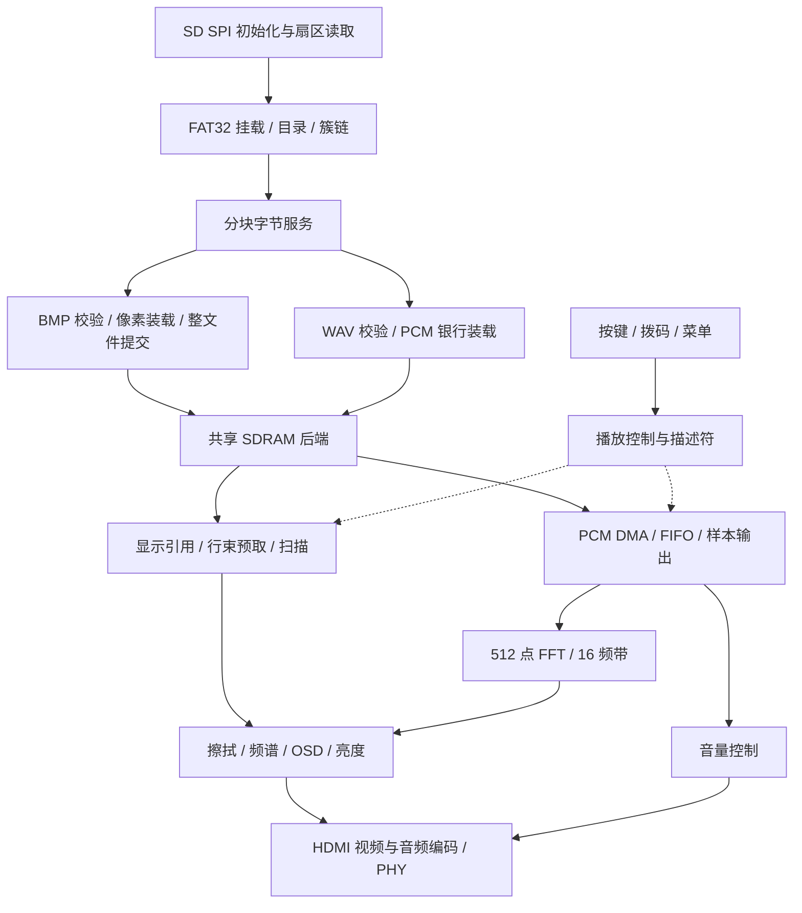

# FPGA 智能多媒体展播终端技术设计

本文解释默认产品配置的模块职责、数据流、时钟、缓存与复现方法，面向希望理解实现或维护工程的开发者。建议先用 [README](../README.md) 完成整机操作，再按本文定位源码。

本文统一依据公开仓库默认产品源码及 **GUI MultiSeed seed 20** 的实现结果。资源、时序和板上运行说明均以 seed 20 为基准；技术参数直接对照 RTL、ADC、SDC 以及 timing_seed20 目录中的报告。

## 1 设计目标与范围

系统把 TF 卡中的四幅图片和同编号短配音组织成离线展示序列。FPGA 独立完成文件访问、格式检查、图像缓存、播放交互和 HDMI 发送，不通过软核 CPU 执行播放器程序。PC 只用于准备素材、构建和下载。

当前输入为固定 640×480 BMP24/RGB565，输出为 720p60，配音为 1 至 5 秒 PCM WAV。四槽是实际产品容量；内部文件上下文和保留地址不能理解为更多图片、多客户端或长音频功能。

设计首先保证输出扫描连续，再通过缓存与握手协调后台文件读取。TF 卡暂停不能直接改变 HDMI 行场时基，消费者解析完成也不能直接等同于可发布。资源有限，因此采用固定规格、共享 SDRAM、行缓存和串行 FFT。

## 2 系统分层



| 层次 | 主要入口 | 职责 |
| --- | --- | --- |
| 整机 | [multimedia_top.v](../rtl/top/multimedia_top.v) | 时钟复位与全部业务接线 |
| 存储服务 | [fat32_storage_services.v](../rtl/storage/fat32_storage_services.v) | 挂载、目录、文件字节服务 |
| 卡接口 | [sd_spi_media_port.v](../rtl/storage/sd_spi_media_port.v) | SD 初始化、SPI 访问与扇区传输 |
| 图像 | [bmp_header_check.v](../rtl/media/bmp_header_check.v)、[bmp_file_commit.v](../rtl/media/bmp_file_commit.v) | 格式、像素与整文件提交 |
| 音频装载 | [wav_parser.v](../rtl/media/wav_parser.v)、[wav_sdram_loader.v](../rtl/audio/wav_sdram_loader.v) | PCM 格式校验与银行写入 |
| SDRAM | [sdram_shared_rw.v](../rtl/sdram/sdram_shared_rw.v)、[sdram_stream_controller.v](../rtl/sdram/sdram_stream_controller.v) | 客户端仲裁、初始化、刷新与完成回执 |
| 显示 | [display_row_bundle.v](../rtl/video/display_row_bundle.v)、[bundle_scanout.v](../rtl/video/bundle_scanout.v) | 行缓存预取、使用和释放 |
| 控制 | [b3_control.v](../rtl/control/b3_control.v)、[play_ctrl.v](../rtl/control/play_ctrl.v) | 启动交接、切图与轮播 |
| 频谱 | [spectrum_top.v](../rtl/audio/spectrum_top.v) | 样本旁路、FFT 与显示结果发布 |
| 叠加 | [osd_overlay.v](../rtl/video/osd_overlay.v) | 状态、菜单、亮度和帧快照 |
| HDMI | [hdmi_data_island_tx.v](../rtl/hdmi/hdmi_data_island_tx.v)、[tmds_gearbox20_phy.v](../rtl/hdmi/tmds_gearbox20_phy.v) | 音视频符号、数据岛与发送 |

## 3 硬件连接

硬件采用 HX4S20C，主器件为 EG4S20BG256，SDRAM 与 FPGA 合封。系统复用板卡电源、50 MHz 晶振、TF 卡与 HDMI_B，不涉及新增 PCB 或外部 MCU 播放器。

| 接口 | 信号 | ADC 引脚 | 用途 |
| --- | --- | --- | --- |
| 晶振 | clk_50m | R7 | 50 MHz 参考 |
| TF SPI | tf_cs_n / tf_sclk / tf_mosi / tf_miso | A12 / A14 / A13 / B14 | 本地媒体读取 |
| K1 / K2 | key1 / key2 | A2 / B2 | 切图 / 轮播，低有效 |
| K3 / K4 | key3 / key4 | B1 / C1 | 菜单 / 参数，低有效 |
| SW1 / SW2 | switches[0] / [1] | C8 / C7 | 初始化周期 |
| LED | auto_mode | A4 | 自动模式，首图前兼作启动错误闪码 |
| 蜂鸣器 | buzzer_n | H11 | 低有效，SW5 为板上物理使能 |
| HDMI 数据 P 端 | hdmi_d_p[2:0] | E1 / F1 / G5 | LVDS33 |
| HDMI 时钟 P 端 | hdmi_clk_p | C3 | LVDS33 |

引脚依据 [multimedia.adc](../td/multimedia.adc)。HDMI N 端由工具根据器件差分对配对；移植时需要重新核对原理图和封装。顶层未引出 DDC/HPD，因此不提供自动 EDID 协商。

## 4 时钟与复位

### 4.1 时钟关系

| 时钟 | 标称频率 | 主要用途 |
| --- | ---: | --- |
| sys | 50 MHz | 文件、控制、按键、菜单 |
| mem | 100 MHz | SDRAM 调度和控制 |
| device | 100 MHz，相对 mem 延后 7.375 ns | SDRAM 器件采样条件 |
| video_ref | 27 MHz | 第二级视频 PLL 参考 |
| pix | 74.25 MHz | 光栅、叠加、音频样本使能、频谱 |
| word | 37.125 MHz | HDMI 字组织 |
| gear | 185.625 MHz | 发送齿轮转换 |
| serial | 371.25 MHz | HDMI 串行发送相关时钟 |

视频采用两级 PLL：50 MHz 到 27 MHz，再生成像素及相关发送时钟；存储使用独立 PLL。表中为标称值，STA 中的频率以相应工具报告为准。像素总时序 1650×750，标称刷新率为 `74250000 / 1650 / 750 = 60 Hz`。

48 kHz 音频通过像素域时钟使能推进，不把该使能当作自由运行时钟。像素和 word/gear/serial 同源相关，不能整体设为异步以规避正常时序检查。

### 4.2 复位和跨域

顶层以上电状态和三个 PLL 锁定状态建立启动条件，连续合格 1000000 个 50 MHz 周期，即约 20 ms 后再释放业务。失锁会重新触发复位，避免继续使用无效的存储内容与显示引用。

各域通过 `reset_sync` 异步置位、同步释放。数据 RAM 或流水不一定逐位复位，其可用性由同步释放链、控制状态和 valid 保证。跨域使用 mailbox、异步 FIFO 或双时钟 RAM，并依赖配套的请求、确认与资源所有权协议；单独把多位总线逐位双触发同步不能代替事务一致性。

SDC 的例外指向具体同步入口、保持总线和 Gray 指针，不把全部跨域路径一概忽略。SDRAM device 相位、PHY 寄存和读捕获附加延迟与约束共同工作，不能只修改其中一个数字。

## 5 文件读取与分块服务

### 5.1 启动流程

启动先完成 SD SPI 初始化、FAT32 几何解析和 MEDIA 目录扫描，再定位编号 BMP/WAV。扇区读取、预取及字节通路将数据交给消费者，消费者用 ready 背压控制接受时机。

请求接受、最后一个字节被接受、解析器结束、后端写完成、资源提交分别发生。首图必须完整装载并提交才允许显示；启动与正常播放控制之间有明确交接，不能同时向显示发布互相冲突的描述符。

### 5.2 分块上下文

默认 `P0_CONTEXT_ENABLE=1`，文件服务按 512 字节分块推进，并保存文件游标、事务身份及继续读取所需的上下文。底层沿 FAT 簇链取数据；返回结果需与当前会话匹配，避免取消、拔卡或重新挂载后的旧响应污染新文件。

当前产品连接一个客户端。内部多上下文记录仅是实现基础，不能视为实现多客户端并行或更多图片功能。

### 5.3 长度资格检查

完整 32 位文件长度必须在缩窄计数器前进行范围判断。若先截断再判断，高位超限信息已经丢失，例如 `0x01000200` 可能被误当成 512 字节。实现保留原始长度的超限资格，窄计数器只用于已经确认合法的操作。

### 5.4 分块完成条件

这里的“退休”表示当前块的全部副作用已经完成，可以推进游标或回收资源。正确条件需要同时覆盖入口暂存、消费者可自动推进的内部数据、尚未被接受的写请求、已经接受但未完成的后端写。

最后一个文件字节可能刚刚产生一笔待发写，因此在途计数为零仍不保证可以回执。中间块未满 BL8 的数据应留给下一块；文件最终尾包才按既有协议补零。取消也必须等待真实后端事务结束，不通过清空状态冒充写入完成。

## 6 BMP 装载与图像发布

### 6.1 格式资格

| 属性 | 默认要求 |
| --- | --- |
| 尺寸 | 宽 640，高 +480 或 −480 |
| 位深 | 24 位 BMP 或 16 位标准 RGB565 |
| 压缩标志 | BMP24 为 BI_RGB；RGB565 为 BI_BITFIELDS |
| RGB565 掩码 | 标准 R/G/B 掩码，不能混用 RGB555 |
| BMP32 | `BMP32_EN=0`，默认关闭 |

解析器检查标识、头部、尺寸、位深、像素偏移和文件边界，并根据高度正负处理 bottom-up/top-down 顺序。图片在 SDRAM 统一保存为 `0x00RRGGBB` 32 位像素字，显示侧读取统一格式。

### 6.2 槽位提交

图像写入目标槽后，来源结果、格式检查、像素数量和后端完成结果共同决定是否提交。文件头正确或最后一个像素从解析器输出，都不是完整装载成功的充分条件。

物理槽加 generation 区分不同时刻的内容，播放描述符提供目标与身份。旧图被显示或擦拭引用期间不能回收。切换确认和释放协议保证新旧资源可以安全共存，不依赖业务代码猜测某个槽“应该已经不用”。

### 6.3 行缓存与扫描

显示侧通过 `display_row_bundle` 和 `bundle_scanout` 组织行束、预取和双行缓存，申请、就绪、显示和释放状态相互约束。描述符中的源行和相位需与实际光栅坐标同拍对应。

显示具有行截止需求，后台文件写入不能破坏连续扫描。欠载时记录故障并跳过已错过的行，避免一直追赶旧行。当前产品使用固定显示路径，保留缩略图参数和地址未作为默认展示功能启用。

### 6.4 转场和像素流水

`wipe_ctrl` 用 18 帧水平擦拭切换新旧图片，约 0.3 秒。首次显示没有旧图，直接输出新图。所有叠加流水必须将 RGB、DE、HS、VS 和坐标同步延迟；只延迟颜色而不延迟有效信号会造成边缘错位。

## 7 SDRAM 内存与调度

### 7.1 字节地址规划

以下来自 [mem_map.vh](../rtl/include/mem_map.vh)，区间右端不包含。32 位字地址接口需要将字节地址右移两位。

| 区域 | 起始 | 结束 | 预留容量 |
| --- | --- | --- | --- |
| 图槽 0 | 0x000000 | 0x140000 | 1.25 MiB |
| 图槽 1 | 0x140000 | 0x280000 | 1.25 MiB |
| 图槽 2 | 0x280000 | 0x3C0000 | 1.25 MiB |
| 图槽 3 | 0x3C0000 | 0x500000 | 1.25 MiB |
| PCM A | 0x500000 | 0x600000 | 1 MiB |
| PCM B | 0x600000 | 0x700000 | 1 MiB |
| 缩略图保留区 | 0x700000 | 0x740000 | 256 KiB |
| 工作保留区 | 0x740000 | 0x800000 | 768 KiB |

单图有效数据 `640×480×4 = 1228800` 字节，四图合计 4915200 字节。槽间预留不是新增槽；总地址空间 8 MiB，也不是可任意分配给长音频的连续空闲区。

### 7.2 共享控制

显示读取、PCM DMA 与装载写入共用一套后端，统一控制初始化、刷新、银行时序和实际 SDRAM 命令。显示行期限、PCM FIFO 紧急需求与后台写入保护共同影响服务顺序。

已经接受的 BL8 写段需要供满规定写拍，取消不能截断物理事务。顶层 mem 为 100 MHz，刷新间隔和宽限各 750 拍，即 7.5 μs；最大开行 8000 拍，即 80 μs。PHY 相位和读延迟应结合当前 SDC 核对，而非孤立复制参数。

## 8 WAV 配音与音量

### 8.1 输入格式

解析 RIFF/WAVE、fmt、data 及块边界，只接受 PCM 格式标识 1、2 声道、48000 Hz、16 位、block align 4、byte rate 192000。PCM data 长度 192000–960000 字节且为 4 的倍数，完整 WAV 不超过 983040 字节。

每个双声道样本帧占 4 字节，因此 `48000×2×2 = 192000` 字节/秒，对应 1 至 5 秒范围。改变扩展名、提高 TF 卡速度或增加文件大小，不能自动得到新的解码能力。

### 8.2 双银行与声画切换

WAV 写入未发布 PCM 银行，整文件检查、尾块处理及后端写入合格后才允许引用。双银行将当前播放和下一段准备分开，防止覆盖正在读取的数据。

`wav_audio_control` 协调银行准备、取消和回执，使用 bank/token 匹配响应；DMA 经 FIFO 向样本口提供数据，最终由音量与 HDMI 音频通路输出。显示引用和音频选择根据已提交播放身份协调，不能在显示切换前随意复用银行。

同编号配音缺失或无效时使用测试音回退。WAV/TONE 状态比“听到声音”更能帮助定位来源；频谱有柱形也不等于指定 WAV 成功播放。音量 00 静音，01–16 为其余档位，使用已有增益过渡逻辑。

## 9 频谱与 OSD

频谱旁路取左右声道平均值，512 点串行 DIT FFT 使用定点运算，随后归并到 16 个频带并按帧发布柱高。分析忙时不通过该旁路阻塞主音频。

这是可视化频谱，不是校准的声压或功率仪器。左右反相信号可能在平均时抵消；柱高还受定点缩放和显示映射影响。隐藏频谱只关闭叠加，后台计算继续。

OSD 状态经 mailbox 进入像素域，在垂直消隐处快照，帧内保持稳定。图片 ID 和 WAV/TONE 取实际已提交引用，避免菜单状态先于真实播放生效。亮度处理和文本、频谱沿同步像素流水叠加。

| 菜单 | K4 短按 | K4 长按 | 档位规则 |
| --- | --- | --- | --- |
| MODE | AUTO | MAN | 按需切换 |
| PERIOD | 下一档 | 上一档 | 1/2/3/5/10/15/20/30/45/60 秒，端点饱和 |
| DISP | 正向切换 | 反向切换 | ALL / NOID / NOSP / OFF 循环 |
| BRIGHT | 增亮 | 减亮 | 01–16 饱和 |
| VOLUME | 增大 | 减小 | 00–16 饱和 |

按键先同步，再以 1 ms 使能消抖 20 次。K3 短按翻页，长按不动作；K4 长按门限约 750 ms，一次按键只形成对应事件。SW1/SW2 只初始化锁存，上电手动，K2 启动自动模式。OSD 周期以秒表示，例如带前导零的 `015S` 是 15 秒，不能读成 1.5 秒。

## 10 自主 HDMI

发送路径包括视频 TMDS 编码、TERC4、音频数据岛、InfoFrame、ACR 以及符号打包和器件 PHY。视频与 LPCM 经同一 HDMI_B 输出，不通过外接播放器完成配音。

当前固定 720p60，不引出 DDC/HPD，不宣称自动协商或任意模式。显示器可出图不代表具备扬声器或 HDMI 音频播放能力，验证时应分别检查图像、音频来源和接收端配置。

## 11 素材与工程复现

### 11.1 素材检查

先用仓库原素材排除接线和构建问题，再逐个替换 BMP 和同编号 WAV。可使用以下命令生成并检查统一 3 秒配音：

```bash
ffmpeg -i input.wav -af apad -t 3 -ar 48000 -ac 2 -c:a pcm_s16le P0001.WAV
ffprobe -v error -show_entries stream=codec_name,sample_rate,channels,bits_per_sample -of default=noprint_wrappers=1 P0001.WAV
```

预期为 pcm_s16le、48000、2、16；仍需检查 data 与整文件大小。BMP24 用 BI_RGB，RGB565 需标准 BI_BITFIELDS 掩码，不把 RGB555 或 32 位 BMP 作为默认支持。

### 11.2 构建输入

使用 TD 6.2.1，器件 eagle_s20.db / EG4S20BG256，顶层 multimedia_top。`td/multimedia_top.f` 包含 85 个活动 Verilog 文件；另有两个头文件。ADC/SDC 与源码一起决定硬件实现，按产品清单导入，避免混入其他配置。

GUI 实现结果为 MultiSeed seed 20。`BUILD.tcl` 同样设置 seed 20，但二者完全等效尚未验证。脚本按自身定位输入，输出在仓库同级 `build/td_时间戳/`。它生成位流和本次报告，不保证重现相同布局与裕量。

### 11.3 维护时的验证入口

公开仓库没有附独立仿真测试集、校验包或现成位流，不能引用本地维护仓库的脚本作为读者可直接运行的入口。源码中的器件原语也需要对应工具库，不能把缺少原语模型的通用编译视为完整工程构建。

## 12 验证记录与边界

### 12.1 当前 seed 20 记录

| 项目 | 记录 |
| --- | --- |
| 工具 | Tang Dynasty v6.2.168116，TD 6.2.1 系列 |
| 报告时间 | 报告记录为 2026-11-01 17:29:03 |
| 目标 | multimedia_top / EG4S20BG256 |
| setup / hold 最差裕量 | +0.118 ns / +0.120 ns |
| STNS / HTNS | 0 / 0 ns |
| LUT / 寄存器 | 16579 / 10642 |
| BRAM9K / BRAM32K | 25 / 4 |
| DSP / PLL | 5 / 3 |
| 板上运行 | 用户反馈 GUI seed 20 位流上板通过 |

来源：[run.log](../timing_seed20/run.log)、[路由报告](../timing_seed20/hdmi_player_pr.timing)、[例外报告](../timing_seed20/hdmi_player_exception.timing)。资源与时序数值来自上述 seed 20 实现报告。

### 12.2 警告与测量边界

日志包含 PHY-7002（SDRAM 实例位置未满足）、PHY-5079（局部时钟布线）和 PHY-5014（PLL 反馈相关）警告。正裕量不消除这些记录，警告也不直接证明板上失败；后续应结合具体实例、器件规则和实际测量核查。

SDC 没有外部 IO 输入输出延时，当前结果不能替代完整板级外部时序签核。STA coverage 99.99% 是工具统计，不表示所有系统场景或电气指标均覆盖。总体上板反馈不扩展为长时运行、功耗、固化断电启动或多接收端兼容性均已实测。

### 12.3 建议验收矩阵

| 类别 | 检查内容 | 保存记录 |
| --- | --- | --- |
| 输入完整性 | 85 文件、头文件、顶层、ADC/SDC | 提交号及输入摘要 |
| 物理 | 资源、有效路径组 setup/hold、全部警告 | 原始日志与路由报告 |
| 图像 | 四图、两类位深、正负高度、擦拭 | 素材与显示结果 |
| 音频 | 合规配音、缺失/坏文件回退、静音 | 区分 WAV 与 TONE |
| 控制 | 全部按键、长短按、菜单端点、拨码 | 操作步骤与响应 |
| 恢复 | 拔卡重插、重复切换、重新初始化 | 现象、输入和重现步骤 |
| 专项 | 固化、长期、兼容性、功耗、电气 | 未测项目明确标注待验证 |

## 13 故障定位与维护

无 HDMI 信号先核对供电、下载、HDMI_B、线缆和接收端，再检查时钟与约束；有画面但图片不对，再核对 FAT32、目录、命名、尺寸和位深。配音问题先看 WAV/TONE，再核对 PCM 参数，不用频谱柱高代替文件播放验证。

重建应使用对应提交、工具、约束和本次原始报告核对，不能只比较 bit 文件名。修改配置或重新生成位流后，需独立检查资源、时序及实际运行。

若未来增加图片、改变分辨率或实现长音频，需重新核算地址空间、行截止、实时带宽、PCM 缓冲和器件资源。本文描述当前实现，未把这些方向计入现有能力。

感谢赛事组委会、安路科技与康芯科技的支持。第三方资料、工具和标志归原权利人；仓库未指定许可证时，不自动推定再分发许可。
